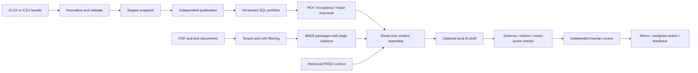

# Brickline · Asset Intelligence Workbench

[](https://github.com/christianwhollar/asset-intelligence-workbench/actions/workflows/ci.yml)

A real estate operating workbench that turns rent rolls, monthly statements, and asset documents into a review queue. Find upcoming lease exposure, trace an operating metric to its source rows, test a downside scenario, and prepare a source-backed brief with an independent review and a named follow-up owner.

The application has a complete browser workspace and API. Its fictional portfolio contains **six industrial and office properties, 36 leases, 720 monthly statement rows, and 24 source documents**. It uses no employer or proprietary investor data.

## Run it

```bash
python3.12 -m venv .venv
source .venv/bin/activate
pip install -c constraints.txt -e '.[dev]'
python -m brickline.serve --demo
```

Open **http://127.0.0.1:8106**. The default workflow computes figures and retrieves exact passages without downloading a model. The CLI permits demo identities only on loopback.

For real local-model drafts:

```bash
ollama pull qwen2.5:3b
python -m brickline.serve --demo --model qwen2.5:3b
```

`docker compose up --build` runs the offline demo with a persistent database and a loopback-only published port. The OpenAPI contract is at `/openapi.json`.

## A five-minute walkthrough

1. **Portfolio:** open Cedar Exchange. Inspect its lease expirations, monthly NOI, and source row numbers. Reduce operating income in the sensitivity panel and compare reserve-adjusted debt coverage.
2. **Data room:** download and upload the error example. The unknown property reference and missing monthly rent account are reported; the current portfolio stays intact. Upload a corrected full snapshot, then have a different reviewer publish it. Previously published snapshots can be restored with a concurrency check.
3. **Documents & evidence:** search Harbor Logistics for “renewal notice.” The result includes the exact passage, document revision, page, and citation identifier. Reviewer-only credit notes are filtered before retrieval.
4. **Review briefs:** build a brief asking “What renewal notice and capital works need attention?” Optional Ollama drafting uses the retrieved passages and computed facts. Switch to Reviewer, open the analyst's brief, record a review note, and export the memo.
5. **Action register / Activity:** assign a follow-up and update its status. Record whether a brief was useful. Actual usage and feedback appear in the activity view. Revoking or revising a source withholds stale brief content and blocks approval or export until it is rebuilt.

## How the workflow fits together



Structured data is the source of financial calculations. The model cannot run arbitrary SQL, change figures, publish an import, approve a brief, contact tenants, or authorize expenditure. Model text remains an explicitly unverified draft; citation membership and quote checks do not establish that every generated claim follows from its evidence.

The application is intentionally a single-host reference implementation. It demonstrates application behavior and operational controls, not prior commercial deployment or institutional scale.

## Recorded checks

- **45 automated tests** cover known-value financial calculations, malformed imports, partial-publication prevention, tenant isolation, review permissions, source revocation, PDF extraction, and model response validation.
- The local study runs **30 fixed synthetic retrieval queries**, eight deliberately corrupted imports, and **24 concurrent updates to one action version**. All eight faults were rejected; one update succeeded and 23 received conflicts. A database backup restored the same portfolio figures.
- **Six actual `qwen2.5:3b` calls**, one per property, passed schema, citation membership, and exact-quote checks. Raw drafts and their retrieved context are retained. This is a contract check on a small synthetic corpus, not an independent accuracy benchmark.

```bash
pytest -q
ruff check src tests scripts
python scripts/evaluate.py --output runtime/local-study
python scripts/evaluate.py --output runtime/live-study --model qwen2.5:3b
```

[Study protocol and results](reports/local-study/report.json) · [Every retrieval query](reports/local-study/retrieval.jsonl) · [Actual model drafts and evidence](reports/local-study/live-drafts.json)

## Data and calculation boundaries

NOI uses twelve complete reporting months and excludes capital expenditure, debt service, and depreciation. Occupancy is leased area divided by gross leasable area at the snapshot date. Lease exposure uses active annual base rent; it does not predict renewal probability or collected cash. DSCR subtracts the separately declared replacement reserve before dividing by scheduled annual debt service. Thresholds are illustrative, not parsed loan covenants.

Scenario capitalization uses explicitly changed trailing NOI and a user-adjusted reference cap rate. It is a sensitivity, not an appraisal or stabilized forecast. It omits prospective concessions, leasing costs, market comparables, and sale costs. The historical [FRED DGS10 series](https://fred.stlouisfed.org/series/DGS10) is dated public context, not a property cap-rate estimator.

[Financial methods and references](docs/methods.md) · [Architecture and decisions](docs/architecture.md) · [Import contract](docs/data-contract.md) · [Operating guide](docs/operations.md) · [Development provenance](DEVELOPMENT.md)
